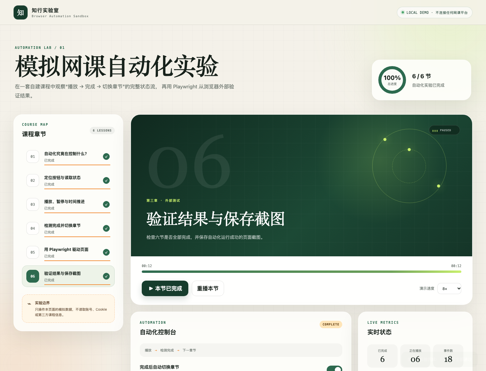

# Course speed pass

一个可安装的 Codex skill，用来创建**完全本地的模拟网课界面**，演示播放状态、章节完成、自动切换、运行日志，以及 Playwright 端到端测试。

> 本项目只适用于自建 Demo、自动化教学和软件 QA。它不会连接学习通或其他真实网课平台，也不提供伪造进度、自动答题、验证码/人脸验证绕过或反检测功能。



## 能做什么

- 从内置模板创建本地模拟课程
- 自定义虚构课程、章节时长与界面文字
- 展示播放、暂停、倍速和自动切换状态机
- 记录实时事件日志并在浏览器本机保存进度
- 使用 Playwright 自动验证课程流程
- 输出 `6/6、100%` 的断言结果和测试截图
- 提供 macOS 双击启动与双击测试脚本

## 作为插件安装

按照 OpenAI 的 GitHub marketplace 方式添加仓库：

```bash
codex plugin marketplace add 1309594350-jpg/course-speed-pass
codex plugin marketplace list
```

然后重启 ChatGPT 桌面应用，在 Plugins Directory 中选择 **Course speed pass** 并安装。

## 只安装 skill

也可以克隆仓库后，把 skill 文件夹复制到个人技能目录：

```bash
git clone https://github.com/1309594350-jpg/course-speed-pass.git
mkdir -p ~/.codex/skills
cp -R course-speed-pass/plugins/course-speed-pass/skills/course-speed-pass ~/.codex/skills/course-speed-pass
```

重新打开 Codex 对话后，可直接调用：

```text
Use $course-speed-pass to create a local simulated course automation lab.
```

## 开发与验证

skill 的确定性安装脚本会把模板复制到一个新的或空的目录：

```bash
python3 plugins/course-speed-pass/skills/course-speed-pass/scripts/create_demo.py \
  --output /absolute/path/to/demo
```

进入生成的 Demo 目录后运行：

```bash
npm install
PLAYWRIGHT_DOWNLOAD_HOST="https://npmmirror.com/mirrors/playwright" npx playwright install chromium
npm run automation
```

## 目录结构

```text
plugins/course-speed-pass/
├── plugin.json
└── skills/course-speed-pass/
    ├── SKILL.md
    ├── agents/openai.yaml
    ├── scripts/create_demo.py
    └── assets/course-demo-template/
```

自动化依赖 [Microsoft Playwright](https://github.com/microsoft/playwright)。本仓库代码采用 MIT License；Playwright 保留其 Apache-2.0 License。
