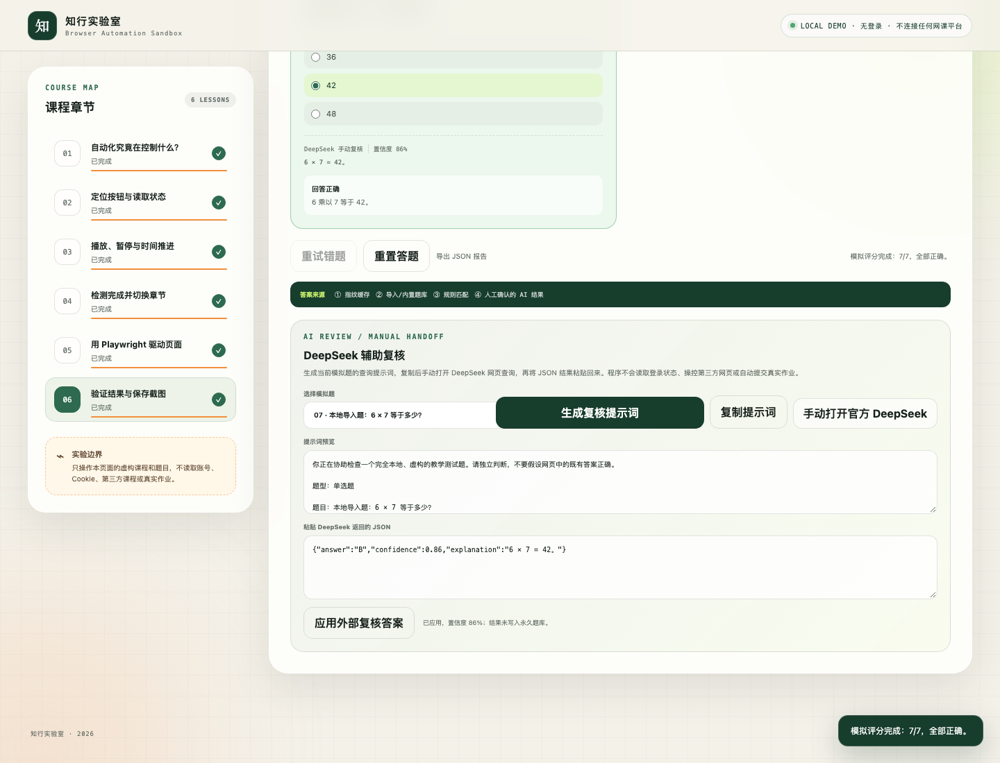
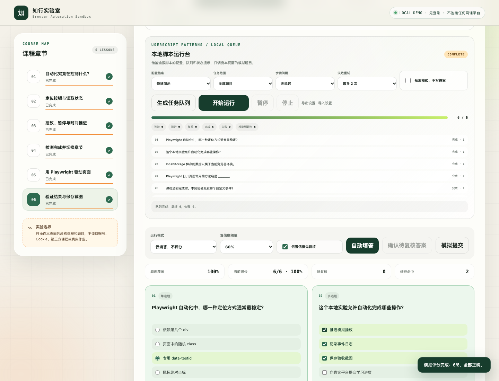

# Course speed pass

一个可安装的 Codex skill，用来创建**完全本地的模拟网课与智能答题实验室**，演示播放状态、章节完成、JSON/CSV 题库导入、置信度复核、人工 AI 辅助、可控任务队列、模拟评分，以及 Playwright 端到端测试。

> 本项目只适用于自建 Demo、自动化教学和软件 QA。它不需要登录，不会连接学习通或其他真实网课平台，也不提供真实课程代刷、真实作业自动答题、账号/Cookie 导入、验证码/人脸验证绕过或反检测功能。DeepSeek 辅助仅为人工复制/粘贴复核，不操控第三方网页。






## 能做什么

- 从内置模板创建本地模拟课程
- 自定义虚构课程、章节时长与界面文字
- 展示播放、暂停、倍速和自动切换状态机
- 记录实时事件日志并在浏览器本机保存进度
- 支持单选、多选、判断与填空的本地模拟答题
- 导入 JSON/CSV 题库，支持校验、指纹去重、合并/替换、统计、导出和恢复
- 提供题目指纹缓存、本地题库、规则匹配和答案来源追踪
- 按置信度拦截待复核答案，支持仅填答/模拟提交、错题重试与 JSON 报告导出
- 为本地虚构题生成 DeepSeek 复核提示词，并接收人工粘贴的 JSON 结果
- 提供油猴式本地运行台：配置档、作用范围、延迟、有限重试、预演、暂停/继续/停止和设置导入导出
- 用可观察的任务队列显示等待、运行、复核、完成、失败等状态，并检测本地动态题卡
- 使用 Playwright 自动验证课程流程
- 输出课程 `6/6`、内置答题 `6/6`、导入题库 `7/7`、运行台控制等完整断言与三张测试截图
- 提供 macOS 双击启动与双击测试脚本

## 作为插件安装

按照 OpenAI 的 GitHub marketplace 方式添加仓库：

```bash
codex plugin marketplace add 1309594350-jpg/course-speed-pass
codex plugin marketplace list
```

然后重启 ChatGPT 桌面应用，在 Plugins Directory 中选择 **Course speed pass** 并安装。

## 只安装 skill

也可以克隆仓库后，把 skill 文件夹复制到个人技能目录：

```bash
git clone https://github.com/1309594350-jpg/course-speed-pass.git
mkdir -p ~/.codex/skills
cp -R course-speed-pass/plugins/course-speed-pass/skills/course-speed-pass ~/.codex/skills/course-speed-pass
```

重新打开 Codex 对话后，可直接调用：

```text
Use $course-speed-pass to create a local simulated course with importable fictional question banks, a controllable local task queue, and manual AI review, then verify it with Playwright.
```

## 开发与验证

skill 的确定性安装脚本会把模板复制到一个新的或空的目录：

```bash
python3 plugins/course-speed-pass/skills/course-speed-pass/scripts/create_demo.py \
  --output /absolute/path/to/demo
```

进入生成的 Demo 目录后运行：

```bash
npm install
PLAYWRIGHT_DOWNLOAD_HOST="https://npmmirror.com/mirrors/playwright" npx playwright install chromium
npm run automation
```

## 目录结构

```text
plugins/course-speed-pass/
├── plugin.json
└── skills/course-speed-pass/
    ├── SKILL.md
    ├── agents/openai.yaml
    ├── scripts/create_demo.py
    └── assets/course-demo-template/
```

自动化依赖 [Microsoft Playwright](https://github.com/microsoft/playwright)。本仓库代码采用 MIT License；Playwright 保留其 Apache-2.0 License。
